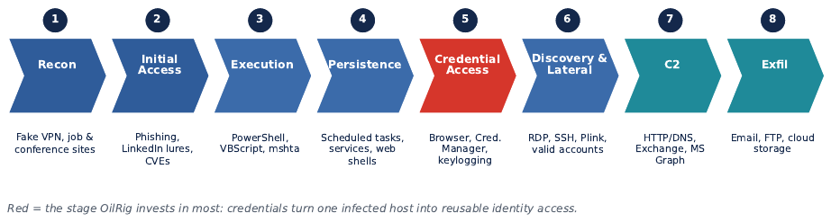

# APT34 / OilRig: Threat Intelligence

Public-source threat intelligence on APT34 (OilRig), the Iranian-linked cyber-espionage group tracked by MITRE ATT&CK as [G0049](https://attack.mitre.org/groups/G0049/). Explore campaign reporting, ATT&CK technique mappings, extracted figures, and practical guidance for detection, threat hunting, and defense.

> **Scope:** Educational and defensive research. This repository is not an IOC feed and does not provide operational instructions.

## Start here

- [Analytical overview](overview.md) - key findings, confidence distinctions, and defender takeaways.
- [Sources and methodology](sources-and-methodology.md) - source tiers, scope, currency, and limitations.
- [Structured report](report/INDEX.md) - the report organized by section.
- [Figure index](figures/README.md) - all 12 report figures, with captions and descriptive alt text.

## At a glance

The report assesses OilRig as a persistent espionage threat whose reported activity has targeted government and strategically important organizations, particularly in the Middle East. Across campaigns, public reporting describes changes in delivery methods, malware, and command-and-control alongside recurring interest in credentials and access to sensitive information. Defenders should therefore combine identity, endpoint, email, network, and cloud telemetry instead of relying on long-lived hashes or infrastructure indicators alone.

Attribution and campaign linkage are assessments, not certainties. Confidence belongs to individual claims and depends on the underlying evidence; a shared tool, victim sector, or regional focus does not by itself establish that activity belongs to OilRig.

## Selected figure

*Figure 1. Simplified OilRig attack lifecycle, synthesized in the report from public reporting and MITRE ATT&CK mappings. See the [full figure index](figures/README.md) for the remaining figures and context.*

## Defensive use

- Use ATT&CK mappings as a starting point for coverage review, then verify that detections match your environment and the underlying source.
- Prioritize phishing-resistant authentication, careful privileged-account controls, script and PowerShell visibility, credential-access monitoring, and review of scheduled-task or service creation.
- Correlate endpoint and identity events with email, DNS, network, Exchange, and cloud-service audit logs.
- Treat hashes, domains, IP addresses, and filenames as time-bound evidence. Record provenance and observation dates, and validate indicators before blocking.

These are general defensive priorities drawn from the report, not a claim that any one behavior uniquely identifies OilRig.

If this research is useful, [star the repository](https://github.com/maramraboudi/apt34-oilrig-threat-intelligence/stargazers) to help other defenders and researchers find it.

## Repository layout

- `report/` - front matter, introduction, chapters, references, appendix, and report index.
- `figures/` - extracted analytical figures and their index.
- `overview.md` - concise analysis and defensive takeaways.
- `sources-and-methodology.md` - sourcing, currency, limitations, and rights.
- `CONTRIBUTING.md` - how to suggest sourced corrections and improvements.

## Contributing

Corrections and well-sourced additions are welcome. Please include the original source, publication date, and the specific claim or section affected. See [CONTRIBUTING.md](CONTRIBUTING.md) before opening an issue or pull request.

## Rights and reuse

No blanket reuse license is granted for this repository. Report text and figures remain subject to their respective rights holders; cited material remains subject to its publisher's terms. See the [rights note](sources-and-methodology.md#rights-and-reuse).
