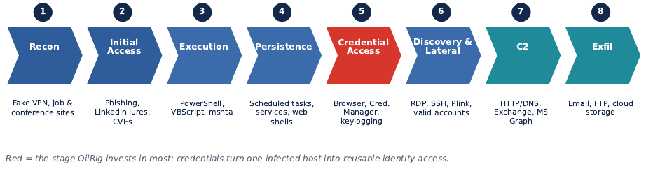
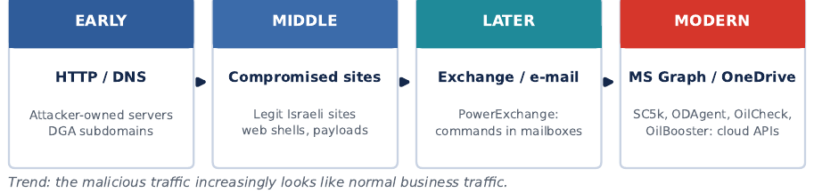
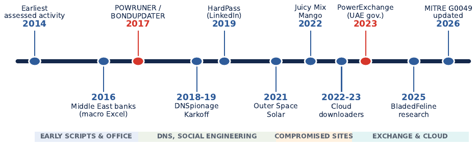
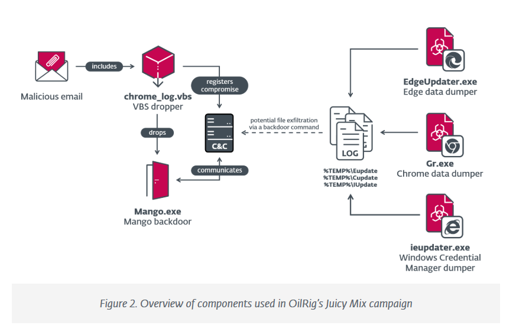
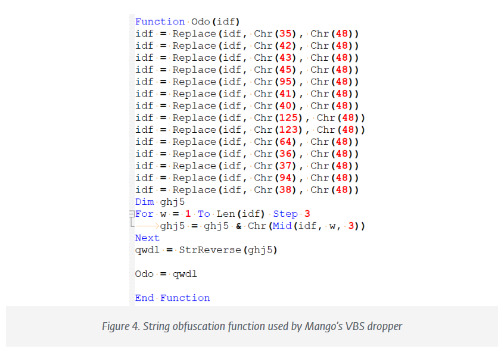
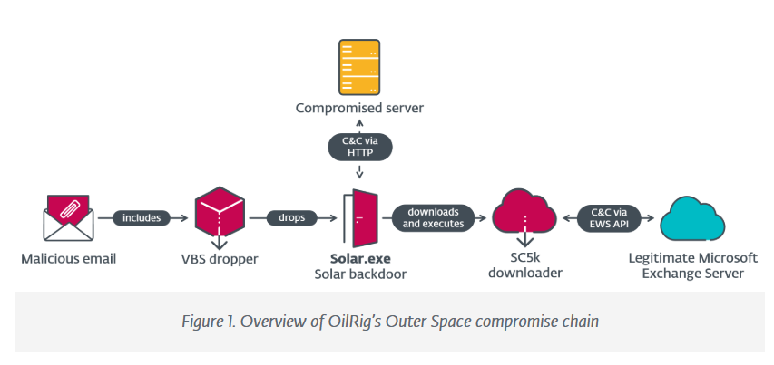

# Report figures

These 12 images are the analytical figures extracted from the original [APT34/OilRig report](../APT34-OilRig-threat-intelligence-report.pdf). The small institutional logo on the report cover is not included. Page numbers below refer to the report's printed page numbers.

Each figure retains its report caption and has descriptive alt text. Captions and interpretations follow the report; the visuals are not independent evidence of attribution.

## Figure 1 — Simplified OilRig attack lifecycle

*Report p. 8. The report synthesizes the lifecycle from public reporting and ATT&CK mappings; red highlights credential access as a high-value stage.*

## Figure 2 — Naming landscape around G0049

*Report p. 9. The report cautions that naming relationships represent reported or assessed overlap, not automatic equivalence.*

## Figure 3 — Confidence levels for reported and assessed relationships

*Report p. 12. Confidence levels reflect the report's cited assessments; they are not independent measurements.*

## Figure 4 — End-to-end OilRig attack chain

*Report p. 18. Red marks the credential stage in the reported attack chain.*

## Figure 5 — Evolution of OilRig command-and-control approaches

*Report p. 21. The report describes a shift toward legitimate cloud services; this does not make such traffic malicious by itself.*

## Figure 6 — Selected milestones in the public history of APT34/OilRig

*Report p. 22. A selected chronology of public reporting, not a complete operational history.*

## Figure 7 — Analytical evolution of OilRig tooling

*Report p. 29. The report explicitly describes this as a progression of tool families, not a direct replacement sequence.*

## Figure 8 — MITRE ATT&CK Enterprise Matrix, version 17

*Report p. 33. This is a historical versioned matrix; consult MITRE ATT&CK for current content.*

## Figure 9 — Representative ATT&CK techniques used by OilRig

*Report p. 33. Technique associations reflect the report's source review and should be checked against current ATT&CK pages.*

## Figure 10 — Components used in OilRig's Juicy Mix campaign

*Report p. 35. Campaign depiction follows the cited research summarized in the report.*

## Figure 11 — String obfuscation function used by Mango's VBS dropper

*Report p. 36. Included as a figure from the report for analytical context; this repository does not provide operational deployment instructions.*

## Figure 12 — OilRig's Outer Space compromise chain

*Report p. 39. The chain summarizes the Outer Space campaign as presented in the report's cited research.*
