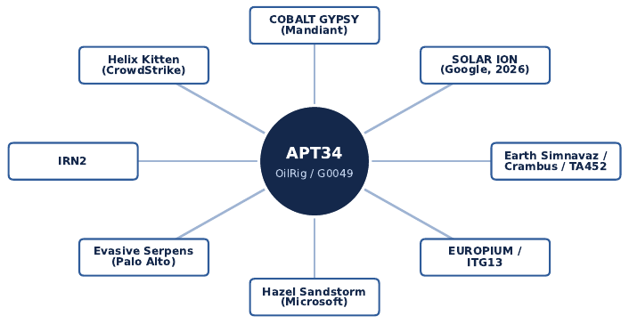
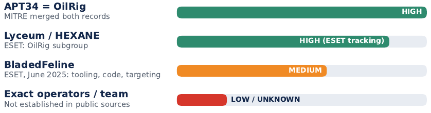

# Chapter I - Profile of the actor

### Report page 9

CHAPTER I Profile of the Malicious Actor
2 Identity and Known Aliases
One actor, many names: the same activity is labelled differently by almost every vendor.
MITRE ATT&CK tracks the group asOilRig (G0049)and associates it with the names COBALT
GYPSY, IRN2, APT34, Helix Kitten, Evasive Serpens, Hazel Sandstorm, EUROPIUM, ITG13,
Earth Simnavaz, Crambus and TA452. Each vendor sees different telemetry and clusters activity in
its own way, so names may be merged, split or refined over time.
•Attribute: Primary name
Assessment: OilRig
•Attribute: MITRE ATT&CK ID
Assessment: G0049
•Attribute: Common alias
Assessment: APT34 (merged with OilRig in MITRE)
•Attribute: Origin / alignment
Assessment: Iran; Iranian government interests assessed
•Attribute: First publicly assessed activity
Assessment: At least 2014
•Attribute: Primary mission
Assessment: Cyber- espionage and intelligence collection
•Attribute: Primary region
Assessment: Middle East, with international victims
•Attribute: Core sectors
Assessment: Government, financial, energy, chemical, telecommunications
2.1 Who calls it what
Figure 2:Naming landscape around G0049. Links show reported or assessed naming overlap, not automatic
identity.
•Name: OilRig
Used by: Palo Alto Networks Unit 42

### Report page 10

How to treat it: Primary actor name; popularized the label
•Name: APT34
Used by: Mandiant (Google Cloud)
How to treat it: Previously tracked separately by MITRE, then combined
•Name: COBALT GYPSY, IRN2
Used by: Secureworks
How to treat it: Associated names in MITRE
•Name: HELIX KITTEN
Used by: CrowdStrike
How to treat it: Associated name in MITRE
•Name: Evasive Serpens
Used by: Palo Alto Networks
How to treat it: Vendor-specific name for G0049
•Name: Hazel Sandstorm, EUROPIUM
Used by: Microsoft
How to treat it: Current and former Microsoft names
•Name: ITG13
Used by: IBM X-Force
How to treat it: Associated name in MITRE
•Name: Earth Simnavaz
Used by: Trend Micro
How to treat it: Associated name in MITRE
•Name: Crambus, TA452
Used by: Symantec, Proofpoint
How to treat it: Associated names in MITRE
•Name: SOLAR ION
Used by: Google Threat Intelligence
How to treat it: 2026 naming system; a renaming, not a new actor
Analyst tip
An alias in a vendor report should not automatically be read as a separate actor . Map every
name to the underlying evidence, and keep APT34/ OilRig as the working term, noting SOLAR
ION as Google’s current label.
3 Attribution Assessment
Iran alignment is well supported; exact organizational control is not public.
Attribution should be written as an evidence-based confidence judgment, never as a binary fact.
For OilRig, several independent evidence streams point the same way, and that convergence is what
makes the case strong.
3.1 Evidence supporting Iranian alignment
•Evidence type: Government assessment
What the public record shows: Mandiant assessed in 2017 that APT34 operated on behalf of
the Iranian government; MITRE repeats this and calls OilRig a suspected Iranian threat group.
•Evidence type: Infrastructure

### Report page 11

What the public record shows: Historical infrastructure contained references to Iran and
used Iranian infrastructure.
•Evidence type: Targeting
What the public record shows: Government, energy, financial, chemical, telecom and Israeli
strategic organizations fit an intelligence-collection profile.
•Evidence type: Technical tradecraft
What the public record shows: A recurring mix of PowerShell, DNS/HTTP C2, credential
theft, Office exploitation, scheduled tasks and custom downloaders appears across campaigns.
•Evidence type: Malware continuity
What the public record shows: Tool succession such as Solar→Mango; ESET assigned
SC5k, OilCheck, ODAgent and OilBooster to OilRig with HIGH confidence.
•Evidence type: Behavior
What the public record shows: Repeated compromise of the same victims and migration
from dedicated C2 to cloud services show a stable operational culture even as tools change.
3.2 Confidence model
•Dimension: Iran alignment
Basis: Infrastructure references, targeting, consistent independent reporting
Confidence: HIGH
•Dimension: Cyber-espionage mission
Basis: Long-term reconnaissance and collection across strategic sectors
Confidence: HIGH
•Dimension: Government sponsorship
Basis: Mandiant and MITRE assessments; organizational details not public
Confidence: HIGH (details not public)
•Dimension: APT34↔OilRig overlap
Basis: MITRE merged previously separate records
Confidence: HIGH
•Dimension: Lyceum relationship
Basis: ESET describes Lyceum/HEXANE/Storm-0133 as an OilRig subgroup
Confidence: HIGH (ESET tracking)
•Dimension: BladedFeline relationship
Basis: ESET: likely subgroup, based on tools, code similarity and targeting
Confidence: MEDIUM
•Dimension: Exact operators / team
Basis: Identities not established; not proven that every cluster is one team
Confidence: LOW / unknown
Overall judgment
APT34/ OilRig is an Iran-aligned, state-sponsored or state-directed cyber-espionage actor, with
HIGH confidence at the broad actor level. The evidence is much stronger for Iran alignment
than for claims about internal structure or individual operators; subgroup claims must keep
their own confidence labels. This prevents over-attribution while remaining useful to defenders.

### Report page 12

3.3 Alternative hypotheses
Some overlaps could reflectother Iranian groups, shared contractors, copied tools or com-
mon open-source components. Lyceum and other Iranian clusters share parts of the regional
targeting picture, so every cross-group relationship must be assessed on its own. Overall attribution
to the OilRig/APT34 cluster isHIGH, but attribution of an individual campaign, subgroup or alias
may be lower.
4 Subgroups and Related Actors
Related does not mean identical: the report keeps confirmed and assessed relationships apart.
Figure 3:How strong is each relationship? Confidence bars follow the assessments cited in this section.
4.1 Lyceum (HEXANE / Storm-0133)
ESET describes Lyceum as anOilRig subgroupand links it to activity against Israeli government,
local-government and healthcare organizations. Tools attributed to this subgroup includeDanBot,
Shark, Milan, Marlin, Solar, Mango, OilForceGTXand downloaders that use legitimate cloud
services for C2. Other vendors track Lyceum separately, which illustrates the naming problem: the
subgroup label keeps a link to the OilRig ecosystemwithoutassuming one identical operational team.
4.2 BladedFeline
Inresearchpublishedon5June2025, ESETassessedwithMEDIUMconfidencethatBladedFeline
is an OilRig subgroup. The assessment rests on three observations: shared Middle Eastern espionage
targeting (including Iraqi and Kurdish officials), OilRig tools such asRDATandVideoSRVon
compromised systems, and code similarities between BladedFeline’sPrimeCacheIIS module and
OilRig’s RDAT backdoor. It is likely related, butnot an unquestionable synonym.
4.3 Collaboration with other Iranian actors
ESET reported cooperation betweenMuddyWaterand Lyceum in 2025. Overlap between Iran-
aligned groups is better described as anoperational relationshipthan as proof of a single organization.
4.4 Confirmed versus assessed relationships
•Confirmed:explicit, well-supported equivalence (for example APT34 = OilRig in MITRE).
•Assessed:evidence points to shared operators or tooling but does not prove organizational
identity (for example BladedFeline).

### Report page 13

•Evidence: Infrastructure
Value for linking: Links campaigns through domains, IPs, services
Strength: High if several pivots agree
Main limitation: Rotates quickly
•Evidence: Malware / code
Value for linking: Connects samples through implementation traits
Strength: High if distinctive
Main limitation: Code can be reused or copied
•Evidence: TTPs
Value for linking: Shows recurring behavior
Strength: Medium–High
Main limitation: Many actors share techniques
•Evidence: Targeting
Value for linking: Ties campaigns to strategic priorities
Strength: Medium
Main limitation: Several groups target the same sectors
•Evidence: Timing
Value for linking: Supports operational continuity
Strength: Medium
Main limitation: Correlation is not causation
•Evidence: Aliases
Value for linking: Normalizes vendor reporting
Strength: High for explicit equivalence
Main limitation: Taxonomies conflict
