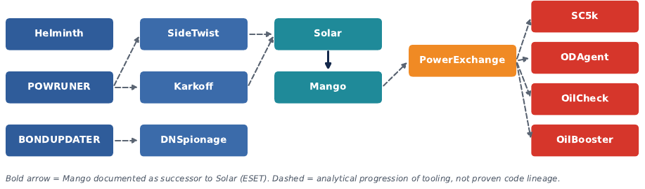
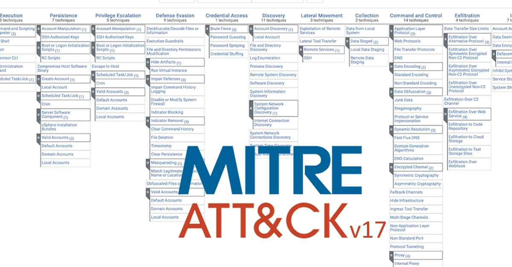
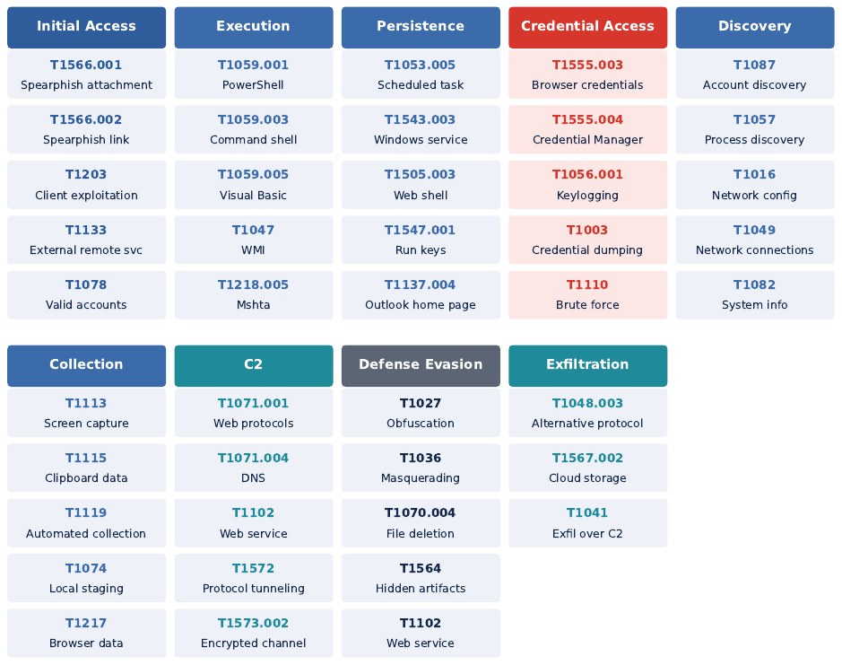

# Chapter VI - Tooling and ATT&CK mapping

### Report page 29

CHAPTER VI Toolkit of the Malicious Actor
16 Malware and Tooling Ecosystem
OilRig does not depend on one signature malware family; it keeps a changing collection of small,
practical tools.
The common thread ispractical utility: lightweight backdoors, downloaders, scripts and creden-
tial stealers that support access, discovery, credential theft and C2. OilRig develops small, task-
focused tools and replaces them when defenders become familiar with a family. The progression
from Helminth and POWRUNER to Solar, Mango, PowerExchange and the cloud downloaders shows
growing specialization around the victim environment.
Figure 7:Analytical evolution of OilRig tooling. This is a progression of tool families, not a claim that each is a
direct code successor of the previous one. Bold arrow = Mango documented as successor to Solar (ESET); dashed
= analytical progression, not proven code lineage.
16.1 Toolkit at a glance
•Tool / family: Helminth
Type: Backdoor / downloader
Key capability: PowerShell, VBScript and batch execution; DNS and web C2; keylogging
Seen in: Early campaigns
•Tool / family: POWRUNER
Type: PowerShell backdoor
Key capability: Command execution, host discovery, file transfer, screenshots
Seen in: 2017
•Tool / family: BONDUPDATER
Type: Downloader
Key capability: Custom DGA for changing C2 subdomains
Seen in: 2017
•Tool / family: SideTwist
Type: Backdoor
Key capability: Command execution, data transfer; small implant
Seen in: Script-based chains
•Tool / family: Karkoff
Type: .NET backdoor
Key capability: Remote commands; installable as a Windows service
Seen in: DNSpionage , 2019
•Tool / family: Solar

### Report page 30

Type: Backdoor
Key capability: C2 and command execution via compromised sites
Seen in: Outer Space, 2021
•Tool / family: Mango
Type: Backdoor
Key capability: Solar successor; credential-theft support
Seen in: Juicy Mix, 2022
•Tool / family: PowerExchange
Type: PowerShell backdoor
Key capability: Exchange email as C2 channel
Seen in: 2023
•Tool / family: SC5k
Type: Downloader
Key capability: Microsoft 365 services for C2 / exfiltration
Seen in: 2022–23
•Tool / family: ODAgent
Type: Downloader
Key capability: Microsoft Graph / OneDrive communication
Seen in: 2022–23
•Tool / family: OilCheck
Type: Downloader
Key capability: Web-service C2, bidirectional transfer
Seen in: 2022–23
•Tool / family: OilBooster
Type: Downloader
Key capability: Web protocols, local staging, encrypted comms, fallback channels, cloud
exfiltration
Seen in: 2022–23
16.2 Script era: Helminth, POWRUNER, BONDUPDATER, SideTwist
Helminth Backdoor / downloader
PROFILE: OilRig family tied to PowerShell, VBScript and batch execution.
CAPABILITIES: MITRE maps it to DNS and web C2, scheduled tasks, registry/startup persistence,
keylogging, clipboard collection and local staging.
POWRUNER and BONDUPDATER 2017 pair
POWRUNER: PowerShell backdoor for command execution, host discovery, file transfer and screenshots.
In 2017 it was launched through Task Scheduler and talked to C2 over HTTP/DNS.
BONDUPDATER: Downloader associated with POWRUNER. Its notable feature is a custom domain-
generation algorithm that produces changing subdomains for C2 and payload retrieval.
SideTwist Backdoor
PROFILE: Lightweight backdoor for command execution and data transfer, reflecting OilRig’s preference
for small implants delivered through simple script-based chains.

### Report page 31

16.3 .NET and DNS era: Karkoff, DNSpionage
Karkoff and DNSpionage 2018–2019
KARKOFF: Lightweight .NET backdoor found during DNSpionage activity; gave remote command
execution and could be installed as a Windows service.
DNSPIONAGE: A campaign/toolset using HTTP and DNS communications, linked to OilRig . Its impor-
tance lies in the combination of remote administration, DNS-based communication and evolving infrastructure
rather than in one executable.
16.4 Compromised-site era: Solar and Mango
Solar and Mango 2021–2022
SOLAR: Main backdoor of the 2021 Outer Space campaign; used with compromised Israeli infrastructure;
supports command execution and C2.
MANGO: Replaced Solar in Juicy Mix (2022). Delivered through VBS and PowerShell chains; works with
credential stealers, scheduled tasks and compromised infrastructure. ESET describes it as a successor to Solar
with overlapping functionality.
16.5 Enterprise-service era: PowerExchange and cloud downloaders
PowerExchange 2023
PROFILE: PowerShell backdoor that uses Microsoft Exchange email for command and data exchange,
moving C2 into a trusted enterprise channel.
SC5k, ODAgent , OilCheck , OilBooster Cloud-service downloaders
SC5K: Uses Microsoft 365 services for communication, so activity looks legitimate at network level.
ODAGENT: Abuses Microsoft cloud services; marks the move away from dedicated attacker-controlled C2.
OILCHECK: Mapped by MITRE to web-service communication and bidirectional transfer.
OILBOOSTER: Extendstheapproachwithwebprotocols, localstaging, encryptedcommunication, fallback
channels and cloud-storage exfiltration: the most modular of the group.
16.6 Malware evolution in one sentence
The major change is not simply “new malware”; it is a change inwhere the malicious logic
lives: from local scripts and dedicated servers toward cloud APIs, email and compromised legitimate
infrastructure.
17 Credential-Stealing Tools and Code Reuse
17.1 Credential tooling
Credential theft is supported by both public and custom tools. MITRE documents LaZagne, PICK-
POCKET, VALUEVAULT, browser stealers such as CDumper and EDumper, and other credential-
focused utilities; Mimikatz and keyloggers also appear in operations.

### Report page 32

•Tool: LaZagne , Mimikatz
Target: Stored and in-memory credentials
Role in the intrusion: Public credential dumping tools
•Tool: PICKPOCKET, CDumper , EDumper
Target: Browser credentials and data
Role in the intrusion: Custom browser stealers
•Tool: VALUEVAULT
Target: Windows Credential Manager
Role in the intrusion: Custom Credential Manager stealer
•Tool: KEYPUNCH
Target: Keystrokes
Role in the intrusion: Keylogging
These tools turn an endpoint compromise into reusable identity access.
17.2 Relationships between tools
The strongest relationships come from functional succession and shared tradecraft: Mango followed
Solar, andtheclouddownloadersshareoneoperatingmodel. Codeandcapabilityoverlapcansupport
attribution, but should be combined with infrastructure, targeting and timing, never treated as proof
by itself, because common libraries and copied public code create false positives.
18 MITRE ATT&CK Mapping
OilRig swaps malware often but reuses familiar behaviors, which is why ATT&CK is such a good
lens.
The current G0049 record maps activity across the whole intrusion lifecycle. The matrix below shows
representative techniques per tactic; it is deliberately selective, not a full dump of MITRE’s record.
The full enterprise matrix provides broader framework context; it is not an OilRig-specific mapping.

### Report page 33

Figure 8:MITRE ATT&CK Enterprise Matrix, version 17.
Figure 9:Representative ATT&CK techniques used by OilRig (credential access highlighted).
18.1 Technique highlights
•Tactic: Initial access
Representative techniques: T1566.001, T1566.002, T1203, T1133, T1586.002, T1199
Pattern: Phishing, client exploits, compromised accounts, external remote services
•Tactic: Execution
Representative techniques: T1059.001, T1059.003, T1059.005, T1047, T1218.005
Pattern: Scriptable execution without one fixed executable; mshta in older chains
•Tactic: Persistence
Representative techniques: T1053.005, T1543.003, T1547.001, T1505.003, T1133
Pattern: Choice depends on the victim environment
•Tactic: Credential access
Representative techniques: T1555.003, T1555.004, T1003, T1056.001, T1110
Pattern: One of the most consistent parts of the toolkit
•Tactic: Discovery
Representative techniques: T1087, T1069, T1057, T1007, T1016, T1049, T1518
Pattern: Quiet preparation before selecting the next host or account
•Tactic: Collection
Representative techniques: T1119, T1217, T1115, T1113, T1074
Pattern: Automated collection and local staging
•Tactic: C2

### Report page 34

Representative techniques: T1071.001, T1071.004, T1102, T1572, T1573.002, T1008
Pattern: HTTP/DNS to compromised servers, Exchange and cloud APIs
•Tactic: Defense evasion
Representative techniques: T1027, T1036, T1070.004, T1564, T1102
Pattern: Obfuscation, masquerading, hidden windows, trusted services
•Tactic: Exfiltration
Representative techniques: T1048.003, T1567.002, T1041
Pattern: Alternative protocols (Exchange, FTP), cloud storage, web services
Coverage gap
ATT&CK gives strong visibility into endpoint and network behavior but not every operational
detail. Gaps are most likely where activity hides inside legitimate services, compromised ac-
counts, cloud APIs or encrypted traffic. Correlate identity, endpoint, DNS, proxy, Exchange
and cloud telemetry rather than relying on malware hashes alone.
